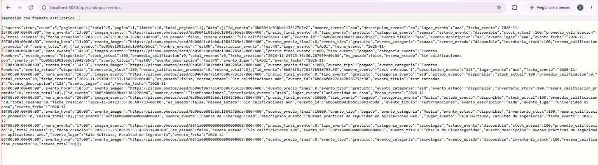
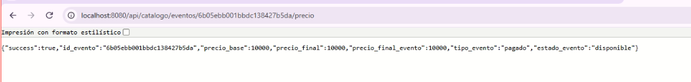
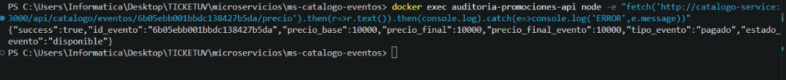

# Guía y Evidencias de Integración de Microservicios

**Módulo:** Catálogo de Eventos  
**Equipo:** Equipo 7  
**Entrega:** Evaluación 4 - Entrega integrada en workstation (antecedentes de la Evaluación 2 en las secciones 1 a 4)  
**Asignatura:** Taller de Integración Tecnológica / Plataforma de Eventos  

---

## 1. Resumen de Configuración del Microservicio

| Parámetro | Valor Oficial de Integración |
|---|---|
| **Nombre del Contenedor** | `ms-catalogo-eventos` |
| **Puerto Interno / Externo** | `3000` (interno Docker) / `4000` (host local) |
| **Red Compartida Docker** | `plataforma-eventos-net` (externa) |
| **Prefijo Oficial de Rutas** | `/api/catalogo/eventos` (alias `/api/catalogo`) |
| **Documentación OpenAPI 3.0** | `/api-docs` (Swagger UI interactivo) |
| **Variable en Gateway** | `CATALOGO_SERVICE_URL=http://catalogo-service:3000` |

---

## 2. Cumplimiento de los 6 Pasos de Integración

### Paso 1: Levantar su servicio
* **Dockerfile:** Imagen ligera basada en `node:22-alpine`.
* **Puerto:** Expone el puerto interno `3000` (`EXPOSE 3000`), publicado en el host como `4000` para evitar colisiones con el front (3000).
* **Comando de arranque:** `CMD ["node", "src/index.js"]`.

### Paso 2: Compartir red (`plataforma-eventos-net`)
El servicio se conecta a la red compartida definida por la cátedra mediante `docker-compose.yml`:
```yaml
services:
  ms-catalogo-eventos:
    build: .
    container_name: ms-catalogo-eventos
    ports:
      - "4000:3000"
    networks:
      - plataforma-eventos-net

networks:
  plataforma-eventos-net:
    external: true
```
* **Comando para crear la red (si no existe previamente en la máquina anfitriona):**
  ```bash
  docker network create plataforma-eventos-net
  ```
* **Comando de despliegue:**
  ```bash
  docker compose up --build -d
  ```

### Paso 3: Respetar rutas (`/api/<modulo>/...` y OpenAPI)
* Todos los endpoints de Catálogo de Eventos responden bajo el prefijo reglamentario:
  * `GET /api/catalogo/eventos`
  * `GET /api/catalogo/eventos/:id`
  * `GET /api/catalogo/eventos/:id/resenas`
  * `PUT /api/catalogo/eventos/:id/stock`
  * `GET /api/catalogo/eventos/:id/info-servicio`
* **Swagger OpenAPI:** Disponible localmente en `http://localhost:4000/api-docs` con esquema JSON descargable en `/docs/swagger.json`.

### Paso 4: Registrar destino (`*_SERVICE_URL`)
* **Variable que expone Catálogo para el Gateway:**
  ```env
  CATALOGO_SERVICE_URL=http://catalogo-service:3000
  ```
* **Variables que consume Catálogo desde la red Docker:**
  ```env
  RESENAS_SERVICE_URL=http://resenas-service:3000
  ORGANIZADOR_SERVICE_URL=http://organizador-service:3000
  ENTRADAS_SERVICE_URL=http://entradas-service:3000
  EXTERNAL_TIMEOUT_MS=500
  ```

### Paso 5: Acordar eventos y contratos (1 Servicio Provisto + 1 Servicio Consumido)

El microservicio cumple con la directriz del profesor René de proveer y consumir servicios acordados:

#### 1. Servicio que Proveemos a otros módulos (Entradas / Inventario):
* **Endpoint:** `PUT /api/catalogo/eventos/:id/stock`
* **Consumidor:** Microservicio de **Entradas / Inventario** tras concretar una compra.
* **Comportamiento:** Actualiza el campo `stock_actual`. Si el nuevo stock es `0`, pasa automáticamente el estado a `'agotado'`; si se repone stock, vuelve a `'disponible'`.

#### 2. Servicio que Proveemos a otros módulos (Reseñas / Promociones):
* **Endpoint:** `GET /api/catalogo/eventos/:id/info-servicio`
* **Consumidores:** **Reseñas** y **Promociones** para validar existencia, título y precio final del evento sin sobrecargar el detalle completo.

#### 3. Servicio que Consumimos de otro módulo (Reseñas):
* **Endpoint consultado:** `POST /api/v1/resenas/calificaciones-basicas` y `GET /api/v1/resenas/evento/:id`
* **Proveedor:** Microservicio de **Reseñas**.
* **Resiliencia (SLA):** Timeout estricto de **500 ms** (`AbortSignal.timeout(500)`). Si Reseñas no responde o falla, Catálogo activa **Graceful Degradation** retornando `"Sin calificaciones aún"` y preservando la navegación y compra sin errores 500.

---

## 3. Evidencias de Pruebas HTTP (Paso 6)

A continuación se presentan los comandos `curl` y las respuestas verificadas del sistema:

### Evidencia 1: Servicio Provisto - Actualización de Stock desde Entradas
**Request:**
```bash
curl -X PUT http://localhost:4000/api/catalogo/eventos/evt-101/stock \
  -H "Content-Type: application/json" \
  -d '{
    "nuevo_stock": 140,
    "token_sesion": "eyJhbGciOiJIUzI1NiIsInR5cCI6IkpXVCJ9..."
  }'
```

**Response (`200 OK`):**
```json
{
  "success": true,
  "message": "Stock actualizado correctamente.",
  "data": {
    "id_evento": "evt-101",
    "evento_id": "evt-101",
    "stock_anterior": 150,
    "nuevo_stock": 140,
    "estado_evento": "disponible",
    "fecha_actualizacion": "2026-10-28T17:40:00.000Z"
  }
}
```

---

### Evidencia 2: Servicio Provisto - Información Ligera para Microservicios
**Request:**
```bash
curl -X GET http://localhost:4000/api/catalogo/eventos/evt-101/info-servicio
```

**Response (`200 OK`):**
```json
{
  "success": true,
  "data": {
    "id_evento": "evt-101",
    "nombre_evento": "Festival de Innovación y Tecnología 2026",
    "precio_final_evento": 15000,
    "estado_evento": "disponible",
    "fecha_evento": "2026-11-15T18:00:00Z",
    "titulo": "Festival de Innovación y Tecnología 2026",
    "precio_final": 15000
  }
}
```

---

### Evidencia 3: Servicio Consumido - Reseñas con Fallback Seguro (Resiliencia)
Cuando el microservicio externo de Reseñas no está disponible o supera el SLA de 500 ms:

**Request:**
```bash
curl -X GET http://localhost:4000/api/catalogo/eventos/evt-101/resenas?limite=3
```

**Response (`200 OK` - Graceful Degradation):**
```json
{
  "success": true,
  "data": {
    "id_evento": "evt-101",
    "evento_id": "evt-101",
    "promedio": 4.5,
    "total_resenas": 12,
    "resenas": [],
    "mensaje": "Información provista con resiliencia de catálogo"
  }
}
```
* **Log del Servidor:**
  ```text
  [BE2] Reseñas no disponible para calificaciones básicas (fetch failed). Preservando métricas locales.
  ```

---

## 4. Instrucciones de Verificación Rápida para Ayudantes / Profesor

1. Clonar el repositorio y ubicarse en la raíz:
   ```bash
   git clone https://github.com/Equipo-7-Catalogo-de-eventos/ms-catalogo-eventos.git
   cd ms-catalogo-eventos
   ```
2. Crear la red compartida (si no existe):
   ```bash
   docker network create plataforma-eventos-net 2>/dev/null || true
   ```
3. Construir y levantar el contenedor:
   ```bash
   docker compose up --build -d
   ```
4. Comprobar que el servicio responde y ver Swagger interactivo:
   * **API:** `curl http://localhost:4000/api/catalogo/eventos`
   * **Swagger:** Abrir en el navegador `http://localhost:4000/api-docs`

---

## 5. Verificación en workstation (Evaluación 4)

**Fecha:** 24-11-2026, sobre la versión de la rama `main` instalada en workstation.

| Parámetro | Valor en workstation |
| --- | --- |
| Contenedor | `ms-catalogo-eventos` (`0.0.0.0:4000->3000/tcp`) |
| Ruta por el API Gateway | `http://localhost:8080/api/catalogo/eventos` |
| Alias en la red | `catalogo-service` |
| Base de datos | Supabase, tabla `eventos` |

**Preparación de datos:** se eliminaron de la tabla `eventos` los eventos de ejemplo que no provenían de Panel Organizador, para que el catálogo muestre los mismos eventos que conoce Entradas. Antes se respaldó la tabla en `eventos_respaldo`.

### I1 - Panel Organizador hacia Catálogo

`GET http://localhost:8080/api/catalogo/eventos` responde con los eventos publicados por Panel Organizador (identificadores de 24 caracteres, por ejemplo `6b05851901bbdc138427b5d2`). Los logs no registran fallas de conexión con Panel.



### I2 - Entradas/Inventario hacia Catálogo

1. `GET http://localhost:8080/api/catalogo/eventos/6b05851901bbdc138427b5d2` mostraba `stock_actual: 100`.
2. Se reservó 1 entrada del evento TestRN desde el módulo Entradas, con el usuario de prueba de Auth.
3. La misma consulta mostró `stock_actual: 8`. Entradas invocó `PUT /stock` y el dato quedó guardado en Supabase.

Entradas informa el stock al reservar. Pagos no estaba operativo durante la verificación, por lo que no se probó una compra completa.

### I3 - Reseñas hacia Catálogo

`GET http://localhost:8080/api/catalogo/eventos/6b05ebb001bbdc138427b5da/resenas` respondió con los datos de Reseñas (`total_resenas: 0`, "Sin calificaciones aún") y sin avisos de "Reseñas no disponible" en los logs. El evento no tiene reseñas porque Reseñas exige check-in previo.

### I5 - Catálogo hacia Promociones

Por el API Gateway, `GET http://localhost:8080/api/catalogo/eventos/6b05ebb001bbdc138427b5da/precio` responde `precio_base: 10000`:



Desde el contenedor de Promociones, la URL interna del catálogo responde el mismo resultado, lo que confirma que la red entre ambos módulos funciona:

```powershell
docker exec auditoria-promociones-api node -e "fetch('http://catalogo-service:3000/api/catalogo/eventos/6b05ebb001bbdc138427b5da/precio').then(r=>r.text()).then(console.log).catch(e=>console.log('ERROR',e.message))"
```



Pendiente de la contraparte: Promociones tiene configurado `CATALOGO_SERVICE_URL=http://ticketu-catalogo:4001`, que no existe en la red. El valor correcto es `http://catalogo-service:3000/api/catalogo`.
