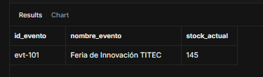
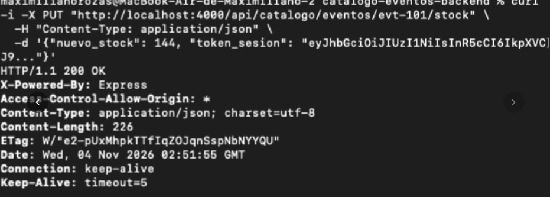
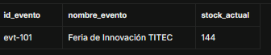

### Evidencia de Base de Datos (BD1) - Integración con Entradas

**Descripción:** Se demuestra la persistencia y consistencia de datos en el Catálogo al recibir una actualización de stock desde el microservicio de Entradas. La operación es trazable por el identificador único del evento.

#### 1. Estado Antes de la Integración
Se ejecuta la consulta para verificar el estado del inventario antes de que el microservicio de Entradas envíe la compra.

**Consulta SQL:**
```sql
SELECT id_evento, nombre_evento, stock_actual FROM eventos WHERE id_evento = 'evt-101';
```

**Captura (Antes):**



*(Nota: El stock actual verificado es de 145 unidades para el evento evt-101)*


#### 2. Ejecución de la Petición HTTP (Backend)
Se evidencia la ejecución de la petición `PUT` desde el entorno de desarrollo simulando la venta de una entrada y enviando el nuevo stock (144). El servidor de Catálogo responde con éxito (`HTTP/1.1 200 OK`).

**Captura (Consola):**


#### 3. Estado Después de la Integración
Se ejecuta nuevamente la consulta de verificación en Supabase para comprobar que la actualización impactó correctamente en la persistencia de datos.

**Consulta SQL:**
```sql
SELECT id_evento, nombre_evento, stock_actual FROM eventos WHERE id_evento = 'evt-101';
```

**Captura (Después):**

*(Nota: El stock actual disminuyó a 144 unidades para el evento evt-101, confirmando el éxito de la integración)*
