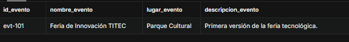
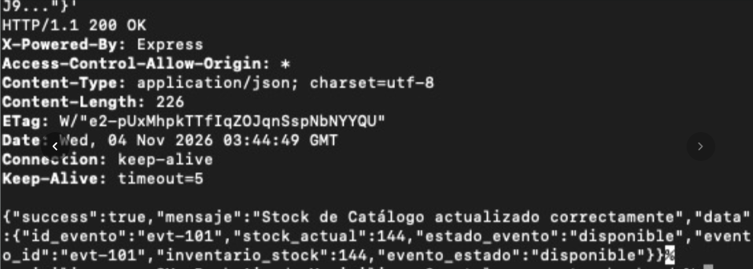
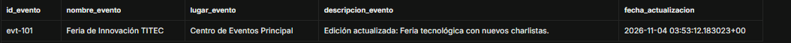

### Evidencia de Base de Datos (BD2) - Integración con Panel Organizador

**Descripción:** Se demuestra la persistencia, consistencia y trazabilidad de los datos en el Catálogo al recibir una actualización de los detalles del evento proveniente desde el microservicio de Panel Organizador.

#### 1. Estado Antes de la Integración
Se ejecuta la consulta SQL para verificar el estado inicial de los datos del evento en la base de datos antes de recibir la actualización del panel.

**Consulta SQL:**
```sql
SELECT id_evento, nombre_evento, lugar_evento, descripcion_evento FROM eventos WHERE id_evento = 'evt-101';
```

**Captura (Antes):**



*(Nota: Verificación de los datos base, con lugar "Parque Cultural" y descripción original, registrados previamente en el Catálogo)*


#### 2. Ejecución de la Petición HTTP (Backend/Panel)
Se evidencia la ejecución de la petición HTTP desde el módulo de Panel Organizador enviando la información actualizada hacia el Catálogo. El servidor procesa la solicitud de forma exitosa devolviendo el estado HTTP/1.1 200 OK y el mensaje de confirmación en JSON.

**Captura (Consola):**


#### 3. Estado Después de la Integración
Se ejecuta nuevamente la consulta de verificación en Supabase incorporando la trazabilidad por fecha y hora (fecha_actualizacion), comprobando que los atributos enviados por el Panel Organizador se persistieron correctamente en la base de datos.

**Consulta SQL:**
```sql
SELECT id_evento, nombre_evento, lugar_evento, descripcion_evento, fecha_actualizacion FROM eventos WHERE id_evento = 'evt-101';
```

**Captura (Después):**


*(Nota: Se confirma la persistencia de los datos actualizados, evidenciando el cambio a "Centro de Eventos Principal", la nueva descripción y la marca temporal de la operación, cumpliendo con los criterios de trazabilidad)*
