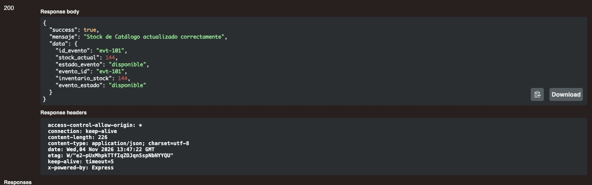
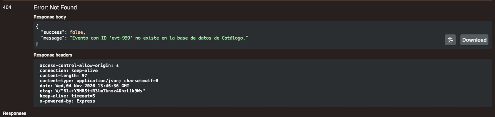

### Evidencia de Calidad (CA1) - Integración con Entradas/Inventario

**Descripción:** Pruebas de la API ejecutadas contra el servicio real de Catálogo para la actualización de stock desde el módulo de Entradas.

#### Caso 1: Flujo Exitoso (200 OK)
* **Resultado esperado:** Al enviar la petición con un ID de evento válido (`evt-101`), el servidor debe procesar la solicitud, actualizar el stock y responder con estado HTTP 200 OK y un mensaje de éxito.
* **Resultado obtenido:** El servidor responde `200 OK` indicando "Stock de Catálogo actualizado correctamente", coincidiendo con lo esperado.

#### Caso 2: Flujo de Error (404 Not Found)
* **Resultado esperado:** Al enviar la petición intentando actualizar un evento que no existe (`evt-999`), la aplicación no debe caerse; debe devolver un estado HTTP 404 Not Found con un mensaje de error controlado.
* **Resultado obtenido:** El servidor responde `404 Not Found` informando que el evento con ID 'evt-999' no existe en la base de datos, coincidiendo con lo esperado.

