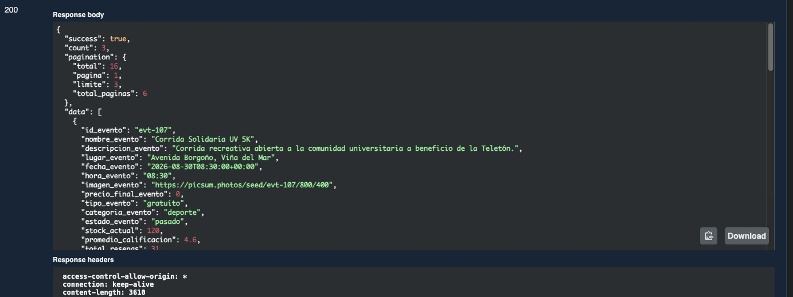
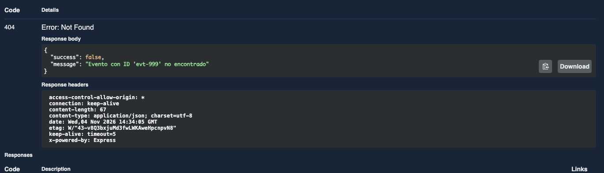

### Evidencia de Calidad (CA1) - Integración con Panel Organizador

**Descripción:** Pruebas de la API ejecutadas para validar la integración de datos de eventos con el módulo Panel Organizador.

#### Caso 1: Flujo Exitoso (200 OK)
* **Resultado esperado:** Al solicitar los datos de los eventos, el servidor debe procesar la solicitud exitosamente y responder con estado HTTP 200 OK, entregando la lista de eventos integrados.
* **Resultado obtenido:** El servidor responde `200 OK` con un JSON válido que contiene los detalles de los eventos y la paginación, coincidiendo con lo esperado.

#### Caso 2: Flujo de Error (404 Not Found)
* **Resultado esperado:** Al consultar los datos de un evento con un ID que no existe (ej. `evt-999`), el sistema no debe fallar, sino devolver un error controlado HTTP 404.
* **Resultado obtenido:** El servidor responde `404 Not Found` informando que el "Evento con ID 'evt-999' no encontrado", manejando la excepción correctamente.

